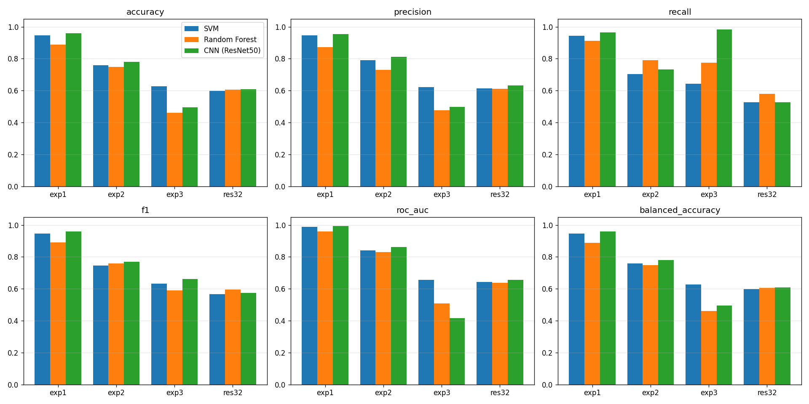
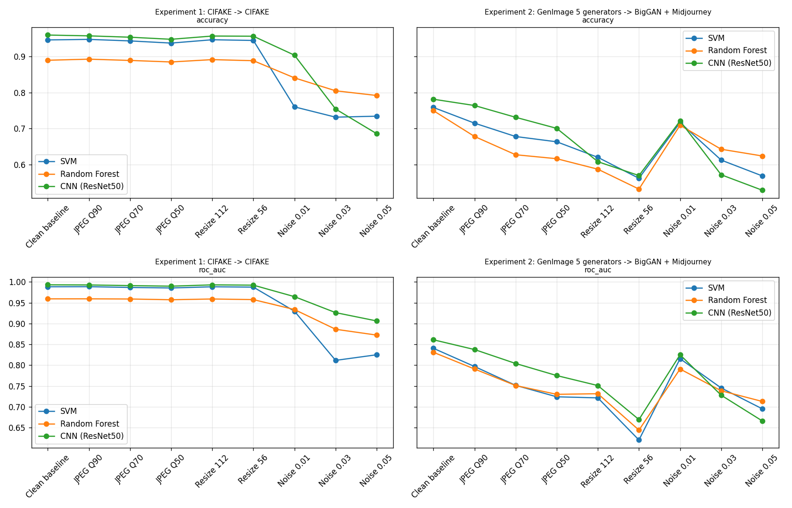

# كشف الصور المولّدة بالذكاء الاصطناعي · AI-Generated Image Detection

مشروع يقارن ثلاثة نماذج لتمييز الصور المولّدة بالذكاء الاصطناعي عن الصور الحقيقية، مع التركيز على **التعميم** على مولّدات غير مرئية و**المتانة** أمام الضغط وتغيير الحجم والتشويش.

A comparison of three detectors of AI-generated images, focused on **generalisation to unseen generators** and **robustness** to JPEG compression, resizing and noise.

## النماذج · Models

| النموذج | المدخلات |
|---|---|
| SVM | ميزات ResNet50 (2048 بُعداً، ImageNet) |
| Random Forest | نفس الميزات |
| CNN | ResNet50 مضبوط بالكامل على مرحلتين |

## التجارب · Experiments

| التجربة | التدريب | الاختبار |
|---|---|---|
| Exp 1 | CIFAKE | CIFAKE |
| Exp 2 | GenImage: ADM, GLIDE, SD1.5, VQDM, Wukong | مولّدات غير مرئية: BigGAN, Midjourney |
| Exp 3 | نماذج Exp 1 بدون إعادة تدريب | اختبار Exp 2 |
| المتانة | نماذج Exp 1 و Exp 2 | JPEG (Q90/70/50)، تصغير (112، 56)، ضوضاء (σ = 0.01/0.03/0.05) |
| 32×32 | بروتوكول Exp 2 بدقة 32×32 | |

ضوابط جودة البيانات: حذف المكرر (SHA-256 و pHash)، وإعادة ترميز كل صور GenImage بـ JPEG Q95 لإزالة اختصار صيغة الملف، وفحص تسريب آلي بين التدريب والاختبار.

## النتائج الرئيسية · Key results (accuracy / ROC-AUC)

| التجربة | SVM | Random Forest | CNN (ResNet50) |
|---|---|---|---|
| Exp 1: CIFAKE | 94.55% / 0.988 | 88.92% / 0.959 | **95.90% / 0.993** |
| Exp 2: مولّدات غير مرئية | 75.86% / 0.840 | 74.98% / 0.831 | **78.14% / 0.861** |
| Exp 2: BigGAN | 82.00% | 82.40% | **84.36%** |
| Exp 2: Midjourney | 69.72% | 67.56% | **71.92%** |

أبرز الملاحظات:
- النماذج ممتازة داخل نفس البيانات، لكن الأداء ينخفض بوضوح على المولّدات غير المرئية، خصوصاً Midjourney.
- النماذج المدرّبة على CIFAKE (صور 32×32) لا تعمّم على GenImage (Exp 3).
- تغيير الحجم أكثر التحويلات ضرراً على بيانات GenImage (دقة CNN تنخفض من 78% إلى 57% عند التصغير إلى 56).

التفاصيل الكاملة في [`results/final_results_report.md`](results/final_results_report.md) والرسومات في [`results/figures`](results/figures).

## التشغيل · How to run

افتح [`AI_Image_Detection_Pipeline.ipynb`](AI_Image_Detection_Pipeline.ipynb) على Google Colab (GPU) وشغّل الخلايا بالترتيب. التفاصيل التقنية وترتيب السكربتات في [`TECHNICAL_README.md`](TECHNICAL_README.md).

## البيانات · Data

- [CIFAKE](https://www.kaggle.com/datasets/birdy654/cifake-real-and-ai-generated-synthetic-images)
- [Tiny-GenImage](https://huggingface.co/datasets/TheKernel01/Tiny-GenImage) (subset of GenImage)

البيانات والنماذج المدرّبة غير مرفوعة في المستودع بسبب حجمها؛ الكود يحمّلها ويعيد إنشاءها.

## الفريق · Team

مشروع جماعي ضمن مقرر دراسي، بمشاركة فريق من ستة طلاب (توزيع الأدوار في `TECHNICAL_README.md`).

> Research prototype, not a production forensic system.
